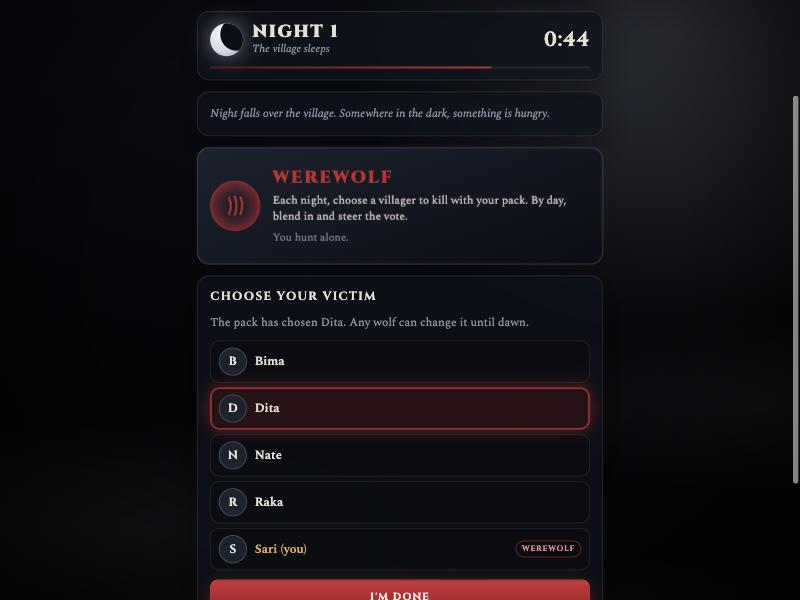

# Werewolf

Hidden roles, night kills and day votes, played online with your friend group. The game is the narrator, so everyone gets to play.

### ▶ [Play now](https://granodioritee.github.io/werewolf/)

## Features

- 5 to 16 players, each on their own phone: create a room and share the invite link
- Werewolves, Seer and Doctor, plus optional Hunter, Jester and Minion the host can switch on
- Nights and days run on timers, with a dawn report of who died and what they were
- Everyone has something to tap at night, so nobody can tell who has a power by watching phones
- A dark, foggy look with sound: howls at nightfall, a bell at dawn, a heartbeat as time runs out

## Nobody can peek, not even the host

The host deals the deck but can't read it. Each player quietly claims a random card that only they can read, so nobody, host included, knows who is what. Wolves see only their pack. The Seer's visions, the night's victim and every revealed role are checked by the database rules against the deck, so they can't be faked.

## How it's built

One HTML file with no build step, hosted on GitHub Pages, with Firebase Realtime Database and anonymous sign-in. The narrator runs in the browser of one online player and hands over automatically if they leave.

---

Made by [granodioritee](https://github.com/granodioritee). Also try [Make it 24](https://github.com/granodioritee/make-it-24) and [Spy Words](https://github.com/granodioritee/spy-words).
